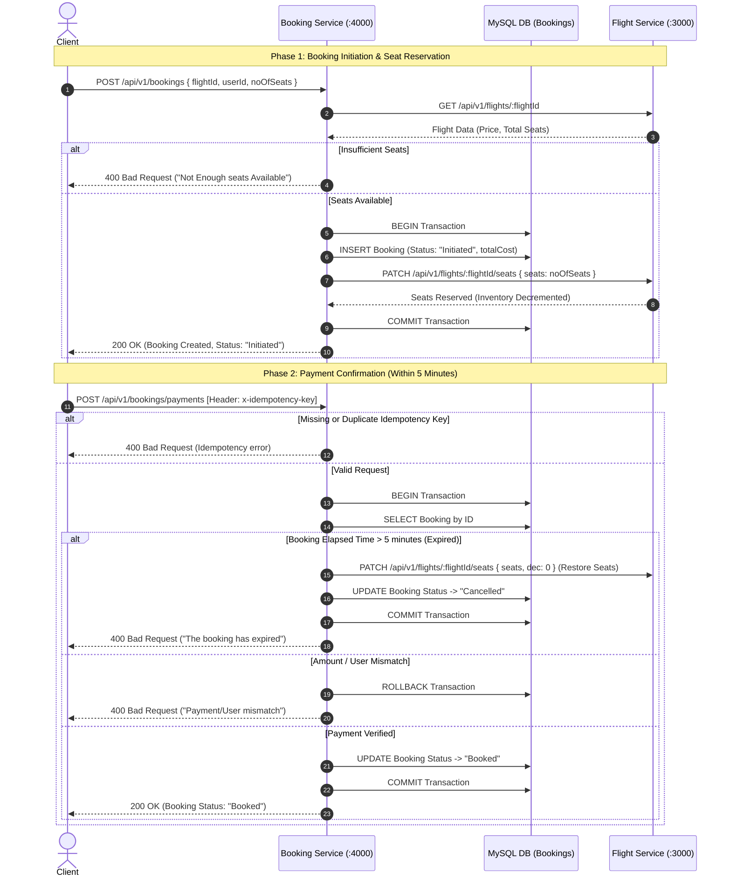

# ✈️ Flight Booking Service

[](https://nodejs.org/)
[](https://expressjs.com/)
[](https://www.mysql.com/)
[](https://sequelize.org/)
[](https://axios-http.com/)
[](https://opensource.org/licenses/ISC)

A production-grade, distributed **Flight Booking Microservice** built with Node.js, Express, and Sequelize ORM. This service manages the entire lifecycle of airline ticket reservations—including real-time seat validation, atomic booking transactions, inter-service communication with the Flight Catalog Service, payment processing with idempotency protection, and automated background cleanup of stale bookings.

---

## 📑 Table of Contents

- [Features](#-features)
- [System Architecture & Workflow](#-system-architecture--workflow)
  - [Microservice Interaction Flow](#microservice-interaction-flow)
  - [Booking State Machine](#booking-state-machine)
- [Tech Stack](#-tech-stack)
- [Project Directory Structure](#-project-directory-structure)
- [Prerequisites](#-prerequisites)
- [Step-by-Step Setup Guide](#-step-by-step-setup-guide)
  - [1. Clone Repository](#1-clone-the-repository)
  - [2. Install Dependencies](#2-install-dependencies)
  - [3. Configure Environment Variables](#3-configure-environment-variables)
  - [4. Configure Database Credentials](#4-configure-database-credentials)
  - [5. Run Database Migrations](#5-run-database-migrations)
  - [6. Start the Service](#6-start-the-service)
- [API Documentation & Reference](#-api-documentation--reference)
  - [Standard Response Formats](#standard-response-formats)
  - [1. Health Check](#1-health-check)
  - [2. Create a Booking](#2-create-a-booking)
  - [3. Process Payment](#3-process-payment)
- [Scheduled Tasks & Cron Jobs](#-scheduled-tasks--cron-jobs)
- [End-to-End Testing Guide](#-end-to-end-testing-guide)
- [Troubleshooting & FAQs](#-troubleshooting--faqs)
- [License](#-license)

---

## ✨ Features

- **Distributed Microservice Architecture**: Communicates via REST with the external **Flight Service** using Axios to verify flight prices, check seat availability, and decrement/increment inventory.
- **ACID Database Transactions**: Employs Sequelize-managed transactions (`sequelize.transaction()`) to guarantee consistency across database writes and downstream network calls, rolling back automatically on failure.
- **Idempotent Payment Processing**: Protects payment endpoints against network retries and duplicate billing via an `x-idempotency-key` header check.
- **5-Minute Reservation TTL & Expiry**: Unpaid bookings expire after a 5-minute window. Trying to pay for an expired booking triggers automatic cancellation and seat release.
- **Automated Stale Booking Sweeper**: Uses `node-cron` to periodically scan and cancel initiated bookings older than 5 minutes that were never completed.
- **Layered Clean Architecture**: Strict separation of concerns following the **Controller-Service-Repository** pattern with a reusable generic CRUD repository.
- **Standardized API Contract**: Consistent JSON response wrappers (`SuccessResponse` and `ErrorResponse`) and custom error classification (`AppError`).
- **Production Logging**: Winston logger integration for request tracking and debugging.

---

## 🏗 System Architecture & Workflow

### Microservice Interaction Flow



### Booking State Machine

```
              ┌─────────────┐
              │  INITIATED  │ ── (Created, seats reserved in Flight Service)
              └──────┬──────┘
                     │
         ┌───────────┴───────────┐
         │                       │
 [Paid within 5m]       [Timeout > 5m OR Cron]
         │                       │
         ▼                       ▼
   ┌───────────┐           ┌───────────┐
   │  BOOKED   │           │ CANCELLED │ ── (Seats released back to Flight Service)
   └───────────┘           └───────────┘
```

---

## 🛠 Tech Stack

| Technology | Purpose |
| :--- | :--- |
| **Node.js** | Server-side JavaScript runtime |
| **Express.js** | HTTP routing and RESTful API framework |
| **MySQL 8.0** | Relational Database for persistent booking records |
| **Sequelize ORM** | Object-Relational Mapper & migration management |
| **Axios** | HTTP client for inter-service REST communication |
| **node-cron** | In-process cron scheduler for automated database cleanup |
| **Winston** | Logging library with file and console transport |
| **http-status-codes** | Standardized HTTP status codes |
| **dotenv** | Environment configuration loader |

---

## 📂 Project Directory Structure

```text
Flight-Booking-service/
├── .env                              # Environment variables (PORT, FLIGHT_SERVICE)
├── .gitignore                        # Git ignore patterns
├── package.json                      # Project dependencies & scripts
├── combined.log                      # Winston combined output log
├── src/
│   ├── index.js                      # Application entry point & server bootstrapper
│   ├── config/
│   │   ├── config.json               # Sequelize DB credentials (dev/test/prod)
│   │   ├── index.js                  # Central configuration exporter
│   │   ├── logger-config.js          # Winston logger format & file transports
│   │   └── server-config.js          # Dotenv loader (PORT, FLIGHT_SERVICE)
│   ├── controllers/
│   │   ├── index.js                  # Controller module exports
│   │   ├── booking-controller.js     # Handles createBooking & makePayment requests
│   │   └── info-controller.js        # Health check endpoint controller
│   ├── middlewares/
│   │   └── index.js                  # Custom request interceptors & validators
│   ├── migrations/
│   │   └── 20260313101504-create-booking.js # Database migration for Bookings table
│   ├── models/
│   │   ├── index.js                  # Sequelize instance initialization & auto-loader
│   │   └── booking.js                # Booking data model definition
│   ├── repositories/
│   │   ├── index.js                  # Repository exports
│   │   ├── crud-repositry.js         # Generic base CRUD repository
│   │   └── booking-repository.js     # Booking-specific queries & transaction handling
│   ├── routes/
│   │   ├── index.js                  # Base API router (/api)
│   │   └── v1/
│   │       ├── index.js              # Version 1 route aggregator (/api/v1)
│   │       └── booking.js            # Booking & payment route definitions
│   ├── services/
│   │   ├── index.js                  # Service module exports
│   │   └── booking-service.js        # Core business logic, pricing, & external calls
│   └── utils/
│       ├── common/
│       │   ├── cron-jobs.js          # Cron task to purge expired unconfirmed bookings
│       │   ├── enums.js              # Booking status & seat type enumerations
│       │   ├── error-response.js     # Standard error response wrapper
│       │   ├── index.js              # Common utilities exporter
│       │   └── success-response.js   # Standard success response wrapper
│       ├── errors/
│       │   └── app-error.js          # Custom Application Error class
│       └── helpers/
│           └── datetime-helper.js    # Date & time comparison utility functions
└── README.md                         # Project documentation
```

---

## 📋 Prerequisites

Before setting up the project, make sure you have the following installed on your machine:

1. **Node.js** (v16.x or v18.x or later) — [Download Node.js](https://nodejs.org/)
2. **npm** (v8.x or later, bundled with Node.js)
3. **MySQL Server** (v8.0 or later) running locally or remotely — [Download MySQL](https://dev.mysql.com/downloads/)
4. **Flight Service** (optional for local mock testing, required for complete booking integration).

---

## 🚀 Step-by-Step Setup Guide

### 1. Clone the Repository

```bash
git clone https://github.com/Darshbhesaniya/Flight-Booking-Service.git
cd Flight-Booking-Service
```

---

### 2. Install Dependencies

Install all required production and development dependencies:

```bash
npm install
```

---

### 3. Configure Environment Variables

Create a `.env` file in the root folder of the project:

```bash
# Windows (PowerShell)
New-Item -Path .env -ItemType File

# Linux / macOS
touch .env
```

Populate `.env` with your port and external Flight Service endpoint:

```env
PORT=4000
FLIGHT_SERVICE="http://localhost:3000"
```

| Key | Description | Default / Example |
| :--- | :--- | :--- |
| `PORT` | Port number on which the Booking Service listens | `4000` |
| `FLIGHT_SERVICE` | Base URL of the Flight Catalog & Search microservice | `http://localhost:3000` |

---

### 4. Configure Database Credentials

Open `src/config/config.json` and update the `development` block with your MySQL credentials:

```json
{
  "development": {
    "username": "root",
    "password": "your_mysql_password",
    "database": "Flight_Booking",
    "host": "127.0.0.1",
    "dialect": "mysql"
  },
  "test": {
    "username": "root",
    "password": "your_mysql_password",
    "database": "Flight_Booking_test",
    "host": "127.0.0.1",
    "dialect": "mysql"
  },
  "production": {
    "username": "root",
    "password": "your_mysql_password",
    "database": "Flight_Booking_prod",
    "host": "127.0.0.1",
    "dialect": "mysql"
  }
}
```

> **Note**: Make sure the database `Flight_Booking` exists in MySQL, or create it beforehand:
> ```sql
> CREATE DATABASE IF NOT EXISTS Flight_Booking;
> ```

---

### 5. Run Database Migrations

Run Sequelize migrations to automatically create the `Bookings` table with all columns and ENUM types:

```bash
# Navigate to src and run migrations
cd src
npx sequelize-cli db:migrate
cd ..
```

*Or run from the root directory specifying the paths:*

```bash
npx sequelize-cli db:migrate --migrations-path=src/migrations --config=src/config/config.json --models-path=src/models
```

#### Database Table Schema (`Bookings`)

| Column | Type | Constraints | Description |
| :--- | :--- | :--- | :--- |
| `id` | `INTEGER` | Primary Key, Auto-increment | Unique booking identifier |
| `flightId` | `INTEGER` | Not Null | ID of the flight reserved |
| `userId` | `INTEGER` | Not Null | ID of the user booking the seats |
| `status` | `ENUM` | Values: `['Booked', 'Pending', 'Cancelled', 'Initiated']`, Default: `Initiated` | Current status of the reservation |
| `noOfSeats` | `INTEGER` | Not Null, Default: `1` | Number of passenger seats reserved |
| `totalCost` | `INTEGER` | Not Null | Total price calculated (`seats * flight price`) |
| `createdAt` | `DATETIME` | Not Null | Creation timestamp (used for 5m TTL) |
| `updatedAt` | `DATETIME` | Not Null | Last update timestamp |

---

### 6. Start the Service

Start the application with nodemon:

```bash
npm start
```

Upon successful startup, you will see output similar to:

```text
Successfully started the server on PORT : 4000
inside Cron Booking Service { ... }
```

The service is now ready to receive HTTP requests on `http://localhost:4000`.

---

## 📡 API Documentation & Reference

### Standard Response Formats

All API endpoints return JSON conforming to standard envelope structures:

#### Success Envelope (200 OK)
```json
{
  "success": true,
  "message": "successfully complete the request",
  "data": {},
  "error": {}
}
```

#### Error Envelope (400 Bad Request / 500 Internal Error)
```json
{
  "success": false,
  "message": "something went wrong",
  "data": {},
  "error": {
    "statusCode": 400,
    "explanation": "Descriptive reason for failure"
  }
}
```

---

### 1. Health Check

Verifies that the Booking Service server is running.

- **URL**: `/api/v1/info`
- **Method**: `GET`
- **Authentication**: None

#### Example Request
```bash
curl --location 'http://localhost:4000/api/v1/info'
```

#### Response (200 OK)
```json
{
  "success": true,
  "message": "API is live",
  "error": {},
  "data": {}
}
```

---

### 2. Create a Booking

Initiates a booking request. The service fetches the flight price and available seats from the Flight Service, reserves the seats by decrementing available inventory, and inserts a new record with status `Initiated`.

- **URL**: `/api/v1/bookings`
- **Method**: `POST`
- **Headers**:
  - `Content-Type: application/json`

#### Request Body
```json
{
  "flightId": 1,
  "userId": 1,
  "noOfSeats": 2
}
```

| Field | Type | Required | Description |
| :--- | :--- | :--- | :--- |
| `flightId` | `Number` | Yes | ID of the flight to be booked |
| `userId` | `Number` | Yes | ID of the customer creating the booking |
| `noOfSeats` | `Number` | Yes | Number of seats to reserve |

#### Example cURL
```bash
curl --location 'http://localhost:4000/api/v1/bookings' \
--header 'Content-Type: application/json' \
--data '{
    "flightId": 1,
    "userId": 1,
    "noOfSeats": 2
}'
```

#### Successful Response (200 OK)
```json
{
  "success": true,
  "message": "successfully complete the request",
  "data": {
    "id": 1,
    "flightId": 1,
    "userId": 1,
    "status": "Initiated",
    "noOfSeats": 2,
    "totalCost": 9000,
    "createdAt": "2026-10-28T05:40:00.000Z",
    "updatedAt": "2026-10-28T05:40:00.000Z"
  },
  "error": {}
}
```

#### Failure Responses

- **Insufficient Seats (400 Bad Request)**:
  ```json
  {
    "success": false,
    "message": "something went wrong",
    "data": {},
    "error": {
      "statusCode": 400,
      "explanation": "Not Enough seats Available"
    }
  }
  ```

---

### 3. Process Payment

Completes an existing reservation. Validates the amount, user ID, and ensures the booking is within the **5-minute expiration window**. Requires an **idempotency key** header to prevent duplicate payments.

- **URL**: `/api/v1/bookings/payments`
- **Method**: `POST`
- **Headers**:
  - `Content-Type: application/json`
  - `x-idempotency-key: <unique-uuid-or-string>` *(Mandatory)*

#### Request Body
```json
{
  "bookingId": 1,
  "userId": 1,
  "totalCost": 9000
}
```

| Field | Type | Required | Description |
| :--- | :--- | :--- | :--- |
| `bookingId` | `Number` | Yes | The booking ID returned from `/api/v1/bookings` |
| `userId` | `Number` | Yes | Must match the `userId` in the booking |
| `totalCost` | `Number` | Yes | Must match the `totalCost` calculated in the booking |

#### Example cURL
```bash
curl --location 'http://localhost:4000/api/v1/bookings/payments' \
--header 'x-idempotency-key: 9f82d56c-1349-4b36-a36b-7d7d519bce32' \
--header 'Content-Type: application/json' \
--data '{
    "bookingId": 1,
    "userId": 1,
    "totalCost": 9000
}'
```

#### Successful Response (200 OK)
```json
{
  "success": true,
  "message": "successfully complete the request",
  "data": [1],
  "error": {}
}
```
*(Status of the booking is updated to `Booked` in the database).*

#### Error Cases & Safeguards

- **Missing Idempotency Key (400 Bad Request)**:
  ```json
  {
    "message": "idempotency key Missing Please Enter"
  }
  ```

- **Duplicate Payment Retry (400 Bad Request)**:
  ```json
  {
    "message": "Cannot retry on a Successful Payment"
  }
  ```

- **Expired Booking (> 5 minutes) (400 Bad Request)**:
  ```json
  {
    "success": false,
    "message": "something went wrong",
    "data": {},
    "error": {
      "statusCode": 400,
      "explanation": "The booking has expired"
    }
  }
  ```
  *(Automatically updates the booking status to `Cancelled` and restores seats in the Flight Service).*

- **Total Cost or User ID Mismatch (400 Bad Request)**:
  ```json
  {
    "success": false,
    "message": "something went wrong",
    "data": {},
    "error": {
      "statusCode": 400,
      "explanation": "The amount of payment doesnt match"
    }
  }
  ```

---

## ⏰ Scheduled Tasks & Cron Jobs

The service features an automated background worker (`src/utils/common/cron-jobs.js`) using `node-cron`:

```javascript
// Runs every 10 minutes
cron.schedule('*/10 * * * *', async () => {
    await BookingService.cancelOldBookings();
});
```

### What does the Cron Job do?
1. Evaluates all bookings in the database created more than 5 minutes ago (`createdAt < Date.now() - 5 minutes`).
2. Checks for records whose status is **neither** `Booked` **nor** `Cancelled` (i.e. abandoned `Initiated` reservations).
3. Automatically marks them as `Cancelled`.
4. Guarantees that unconfirmed locks do not persist permanently in the database.

---

## 🧪 End-to-End Testing Guide

Follow this sequence to test the entire booking workflow:

### Step 1: Ensure External Flight Service is running
Ensure your Flight Service is running on `http://localhost:3000` with flight ID `1` seeded with seats.

### Step 2: Create a Booking
Send a `POST` request to `http://localhost:4000/api/v1/bookings`:
```json
{
  "flightId": 1,
  "userId": 1,
  "noOfSeats": 2
}
```
Note the returned `id` (e.g. `1`) and `totalCost` (e.g. `9000`).

### Step 3: Confirm with Payment within 5 Minutes
Send a `POST` request to `http://localhost:4000/api/v1/bookings/payments` with header `x-idempotency-key: test-key-101`:
```json
{
  "bookingId": 1,
  "userId": 1,
  "totalCost": 9000
}
```
You will receive `200 OK` and the booking status is now `Booked`.

### Step 4: Test Idempotency Guard
Send the exact same request again with the same `x-idempotency-key: test-key-101`.
You will receive `400 Bad Request: "Cannot retry on a Successful Payment"`.

### Step 5: Test Expiration Window
Create a new booking and wait 5 minutes before calling `/payments`.
The payment will fail with `"The booking has expired"`, and the seats will be restored to the Flight Service.

---

## ❓ Troubleshooting & FAQs

### 1. `ECONNREFUSED 127.0.0.1:3306` (MySQL Connection Failed)
- Make sure your MySQL service is running:
  ```bash
  # Windows
  net start MySQL80

  # Linux
  sudo systemctl status mysql
  ```
- Verify the credentials in `src/config/config.json`.
- Ensure the database `Flight_Booking` exists (`CREATE DATABASE Flight_Booking;`).

### 2. `ECONNREFUSED 127.0.0.1:3000` (Flight Service Not Found)
- The Booking Service makes HTTP calls to `FLIGHT_SERVICE`. Ensure the Flight Service is running at the port specified in `.env`.
- If testing locally without the Flight Service, you can spin up a mock server (e.g., using Postman Mock Server or JSON-server) on port `3000`.

### 3. Migrations fail with `Access denied for user`
- Verify that your MySQL username and password in `src/config/config.json` match your local MySQL configuration.

---
